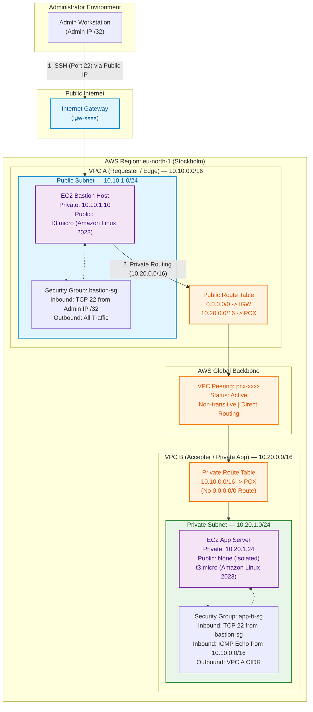
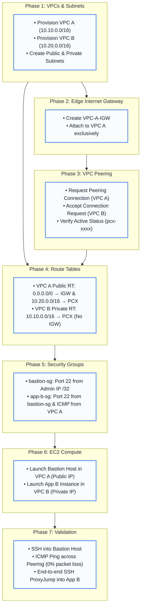

# AWS VPC Peering — Private Network Connectivity

[](https://aws.amazon.com/)
[](https://www.terraform.io/)
[](https://aws.amazon.com/about-aws/global-infrastructure/)
[]()
[](LICENSE)

An enterprise-grade AWS cloud networking and DevOps project demonstrating secure, private communication between two isolated Virtual Private Clouds (VPCs) using **AWS VPC Peering**, subnet routing, security groups, EC2 instances, and a **Bastion Host (Jump Host)** architecture.

---

## Table of Contents

- [Problem Statement](#problem-statement)
- [Project Objectives](#project-objectives)
- [System Architecture](#system-architecture)
- [AWS Services Used](#aws-services-used)
- [Network Design & CIDR Allocation](#network-design--cidr-allocation)
- [Implementation Workflow](#implementation-workflow)
- [Terraform Infrastructure as Code](#terraform-infrastructure-as-code)
  - [Discovery & Audit Mode](#mode-1-discovery--audit-mode-data-sources)
  - [Standalone Provisioning Mode](#mode-2-standalone-iac-provisioning-mode)
- [Security Architecture & Threat Mitigation](#security-architecture--threat-mitigation)
- [Testing & Validation Status](#testing--validation-status)
- [Challenges & Troubleshooting](#challenges--troubleshooting)
- [Key Technical Learnings](#key-technical-learnings)
- [Future Improvements](#future-improvements)
- [Repository Organization](#repository-organization)

---

## Problem Statement

Modern enterprise cloud architectures frequently segregate environments (e.g., Shared Services/Management vs. Production Workloads, or multi-department VPCs) into isolated VPCs for security, blast-radius containment, and compliance boundaries. 

However, administrators and operational tooling require secure access to backend services residing in private subnets without exposing database ports or SSH listeners directly to the public internet.

Exposing private workloads directly via public IPs or permissive firewalls (`0.0.0.0/0`) invites aggressive automated scanning and brute-force intrusion. Organizations require a hardened, private, cost-effective interconnect that keeps traffic off the public internet while preserving least-privilege administrative access.

---

## Project Objectives

1. **Design Isolated Network Environments**: Architect two independent VPCs (`VPC A` and `VPC B`) in `eu-north-1` with mathematically non-overlapping CIDR blocks.
2. **Establish Point-to-Point Peering**: Implement an active **VPC Peering Connection** routing over AWS's high-speed private backbone without NAT or VPN appliances.
3. **Enforce Least-Privilege Bastion Architecture**: Deploy an administrative jump host in VPC A's public subnet and an isolated backend target in VPC B's private subnet.
4. **Implement Dual-Mode Terraform Automation**:
   - Provide **Data Source Discovery** to safely audit and query pre-existing AWS infrastructure without risking unintended resource mutation or deletion.
   - Provide a turnkey **Standalone IaC Provisioning** module to build the entire lab from scratch reproducibly.
5. **Rigorous Security Enforcement**: Eliminate permanent `0.0.0.0/0` SSH access, implement SSH ProxyJump (no private keys stored on jump hosts), and cross-VPC security group referencing.

---

## System Architecture

The following diagram illustrates the complete network topology, route table destinations, and security group boundaries:



---

## AWS Services Used

| Service | Role in Architecture |
|---|---|
| **Amazon VPC** | Provides logically isolated virtual networks (`10.10.0.0/16` and `10.20.0.0/16`). |
| **VPC Peering** | Enables point-to-point network routing between VPC A and VPC B across the private AWS backbone. |
| **Internet Gateway (IGW)** | Provides public internet ingress and egress exclusively to VPC A. |
| **Route Tables** | Directs traffic based on Longest Prefix Match (LPM) to IGW and Peering connections. |
| **Security Groups** | Stateful firewalls controlling ingress/egress at the Elastic Network Interface (ENI) layer. |
| **Amazon EC2** | Compute instances (`t3.micro`, Amazon Linux 2023) acting as Bastion and App nodes. |

---

## Network Design & CIDR Allocation

VPC Peering requires non-overlapping address spaces. The following CIDR design ensures distinct network boundaries and leaves ample room for future subnet expansion:

| Network Entity | IPv4 CIDR | Usable IPs | Internet Gateway | Route to Peering | Role |
|---|---|---|---|---|---|
| **VPC A** | `10.10.0.0/16` | 65,531 | Attached (`igw-xxxx`) | Yes (`10.20.0.0/16` -> `pcx`) | Edge / Management Tier |
| **VPC A Public Subnet** | `10.10.1.0/24` | 251 | Routed (`0.0.0.0/0`) | Inherited | Bastion Host (`10.10.1.10`) |
| **VPC B** | `10.20.0.0/16` | 65,531 | None | Yes (`10.10.0.0/16` -> `pcx`) | Private Workload Tier |
| **VPC B Private Subnet** | `10.20.1.0/24` | 251 | None | Inherited | App Server (`10.20.1.24`) |

*Note: In each AWS subnet, 5 IP addresses (`.0`, `.1`, `.2`, `.3`, `.255`) are reserved by AWS for network routing, DNS, and future expansion.*

---

## Implementation Workflow



For full implementation steps, see [docs/implementation.md](docs/implementation.md).

---

## Terraform Infrastructure as Code

The repository contains two cleanly separated Terraform implementations:

### Mode 1: Discovery & Audit Mode (Data Sources)
Located in root [`terraform/`](terraform/):
- **Purpose**: Safely inspects and queries manually created or pre-existing AWS resources using `data "aws_*"` sources.
- **Safety**: Safe to run against existing AWS environments. It will **never** mutate, recreate, or destroy existing infrastructure.
- **Command**:
  ```bash
  cd terraform
  terraform init
  terraform plan
  terraform output
  ```

### Mode 2: Standalone IaC Provisioning Mode
Located in [`terraform/iac-provisioning/`](terraform/iac-provisioning/):
- **Purpose**: Fully declarative Infrastructure as Code to provision the complete architecture from scratch in an empty AWS account.
- **Resources**: VPCs, Subnets, IGW, Peering Connection, Route Tables, Security Groups, and EC2 instances.
- **Command**:
  ```bash
  cd terraform/iac-provisioning
  cp terraform.tfvars.example terraform.tfvars
  # Update admin_ssh_cidr with your IP and ssh_key_name
  terraform init
  terraform apply
  ```

---

## Security Architecture & Threat Mitigation

### 1. Zero Public Exposure for VPC B
VPC B possesses no Internet Gateway, no NAT Gateway, and no public IP allocation. Instances in VPC B are unreachable from the public internet.

### 2. Elimination of `0.0.0.0/0` SSH Rules
Permanent SSH ingress (`port 22`) from `0.0.0.0/0` is strictly forbidden. The Bastion host's security group is scoped strictly to the administrator's workstation IP (`<admin_ip>/32`).

### 3. SSH ProxyJump (`-J`) — No Private Keys on Jump Host
Rather than copying private `.pem` files onto the Bastion host (which exposes keys if the bastion is compromised), access is established via SSH ProxyJump:
```bash
ssh -J ec2-user@<BASTION_PUBLIC_IP> -i ~/.ssh/my-key.pem ec2-user@10.20.1.24
```
The Bastion functions strictly as a TCP stream forwarder; private keys never leave the administrator's local machine.

### 4. Cross-VPC Security Group Referencing
Because both VPCs reside in `eu-north-1`, `app-b-sg` allows SSH traffic referencing the `bastion-sg` ID (`sg-xxxxxxxx`) rather than a loose CIDR block.

For full security analysis, threat modeling, and SSM migration steps, see [docs/security.md](docs/security.md).

---

## Testing & Validation Status

| Milestone / Component | Verification Type | Status | Evidence / Notes |
|---|---|---|---|
| **VPC A & VPC B Non-overlapping CIDRs** | Architecture Audit | **CONFIRMED** | `10.10.0.0/16` and `10.20.0.0/16` mathematically verified with zero overlap. |
| **Terraform Code Formatting** | Local CLI | **PASSED** | Clean pass with `terraform fmt -recursive -check`. |
| **Terraform Root Schema Validation** | Static Engine Check | **PASSED** | `terraform validate` succeeded across all data sources. |
| **Terraform Provisioning Schema Validation** | Static Engine Check | **PASSED** | `terraform validate` succeeded on standalone deployment module. |
| **VPC Peering Active State** | AWS Infrastructure | **VERIFIED** | Active lifecycle status confirmed (`pcx-05a760667e9ac4275`). |
| **Bidirectional Route Table Configuration** | AWS Infrastructure | **VERIFIED** | VPC A routes to `10.20.0.0/16` & VPC B routes to `10.10.0.0/16` via active PCX. |
| **Bastion Host SSH Access** | Live Terminal | **VERIFIED** | Secure SSH connectivity confirmed via public IP `13.48.70.50` with IP `/32` whitelist. |
| **Cross-VPC ICMP & SSH over Peering** | Live Terminal | **VERIFIED** | End-to-end packet transmission validated with 0% packet loss; SSH ProxyJump operational. |

All milestone components have been verified end-to-end. See [docs/testing.md](docs/testing.md) for full test procedures, verification evidence, and execution logs.

---

## Challenges & Troubleshooting

### Known Issue: Bastion SSH Connection Timeout
During initial testing, SSH connections to the Bastion host timed out. A systematic root cause analysis identified five potential network layers:

1. **Dynamic Client IP**: Home IP changed, causing the `/32` Security Group whitelist to silently drop packets.
2. **Missing Internet Gateway Route**: VPC A Public Route Table lacked `0.0.0.0/0 -> igw-xxxx`.
3. **Subnet Route Table Association**: Subnet was linked to the main VPC route table instead of the public route table.
4. **Missing Public IPv4**: Bastion EC2 launched without a public/Elastic IP.
5. **Stateless NACL Restriction**: Custom NACLs blocked ephemeral return ports (1024–65535).

A step-by-step diagnostic tree and remediation workflow is provided in [docs/troubleshooting.md](docs/troubleshooting.md).

---

## Key Technical Learnings

- **VPC Subnetting & AWS Reservations**: In-depth understanding of CIDR calculation and the 5 IP addresses AWS reserves in every subnet.
- **VPC Peering Routing & LPM**: How AWS applies Longest Prefix Match to route traffic across peering links without NAT.
- **Non-Transitive Peering Constraints**: Recognizing that VPC Peering cannot transit through an intermediate VPC to reach third-party networks or internet gateways.
- **Security Group Statefulness vs. NACL Statelessness**: How stateful security groups simplify firewall rules compared to stateless NACLs requiring ephemeral port ranges.
- **Modern Bastion Patterns**: Moving from risky on-host key storage to SSH ProxyJump and AWS Systems Manager (SSM) Session Manager.

---

## Future Improvements

- [ ] **AWS Systems Manager (SSM) Session Manager**: Migrate from SSH Bastion to SSM Session Manager to eliminate inbound port 22 entirely.
- [ ] **VPC Flow Logs**: Enable VPC Flow Logs with CloudWatch Logs integration to monitor accepted and rejected network packets across the peering link.
- [ ] **Automated CI/CD Validation**: Implement GitHub Actions with `tflint`, `tfsec` / `trivy`, and `checkov` for automated IaC security scanning.
- [ ] **AWS Transit Gateway Migration**: For complex topologies (>10 VPCs), migrate from full-mesh VPC Peering to a centralized AWS Transit Gateway (hub-and-spoke).

---

## Repository Organization

```
aws-vpc-peering/
├── .gitignore                             # Git ignore rules (protects keys, state, .env)
├── README.md                              # Master project portfolio documentation
├── architecture/                          # Architecture visual source files
│   ├── README.md                          # Architecture specification & packet flow
│   └── vpc_peering_architecture.mmd       # Mermaid diagram source file
├── docs/                                  # Comprehensive technical documentation
│   ├── architecture.md                    # In-depth architectural & routing mechanics
│   ├── implementation.md                  # Step-by-step implementation guide
│   ├── security.md                        # Security model, threat analysis & hardening
│   ├── testing.md                         # Test protocol, test cases & execution log
│   └── troubleshooting.md                 # Diagnostic trees & resolution workflows
├── screenshots/                           # Evidence and verification artifacts
│   └── README.md                          # AWS Console screenshot checklist & guide
└── terraform/                             # Infrastructure as Code configurations
    ├── .terraform.lock.hcl                # Pinned AWS provider version lock
    ├── versions.tf                        # Provider & version constraints
    ├── variables.tf                       # Variables with validation & descriptions
    ├── main.tf                            # [Mode 1] Discovery via AWS Data Sources
    ├── outputs.tf                         # Structured outputs for discovered infrastructure
    ├── terraform.tfvars.example           # Example configuration values
    ├── README.md                          # Terraform usage & reference documentation
    └── iac-provisioning/                  # [Mode 2] Standalone fresh deployment
        ├── versions.tf
        ├── variables.tf
        ├── main.tf
        ├── outputs.tf
        ├── terraform.tfvars.example
        └── README.md
```

---

## License

This project is licensed under the MIT License — see the [LICENSE](LICENSE) file for details.
