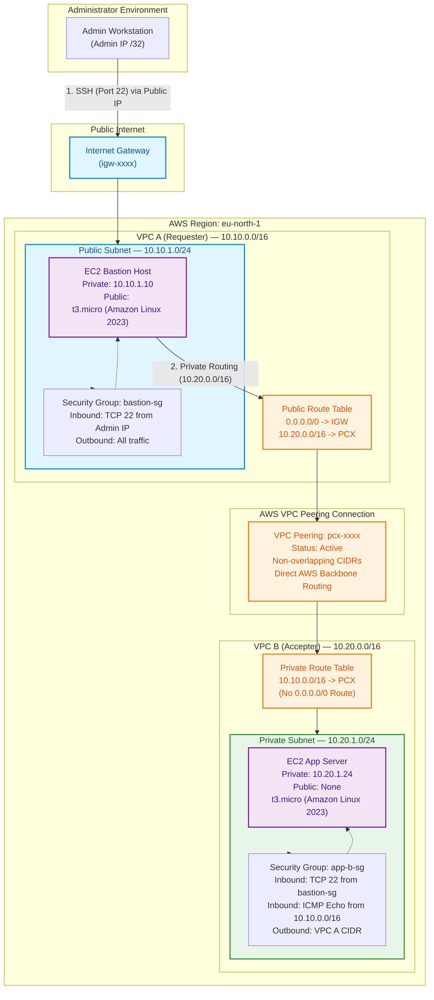

# Architecture Design & Diagrams

This directory contains the system architecture designs, network topology models, and visual source files for the **AWS VPC Peering — Private Network Connectivity** project.

---

## Architecture Diagram Source

The diagram below is rendered from the source file [`vpc_peering_architecture.mmd`](vpc_peering_architecture.mmd) using GitHub Flavored Markdown Mermaid syntax.

---

## Network Component Specifications

### 1. VPC A (Requester / Edge Access Tier)
- **Role**: Ingestion and bastion jump host layer.
- **CIDR**: `10.10.0.0/16` (65,536 addresses).
- **Subnet**: Public Subnet `10.10.1.0/24` (251 usable IP addresses in AWS).
- **Public IP Allocation**: Enabled (`map_public_ip_on_launch = true`) or associated with an Elastic IP.
- **Routing**: Dual target table:
  - `0.0.0.0/0` directs outbound and inbound administrative internet traffic through the Internet Gateway (`igw-xxxx`).
  - `10.20.0.0/16` routes internal cross-VPC traffic over the peering connection (`pcx-xxxx`).

### 2. VPC B (Accepter / Private Application Tier)
- **Role**: Isolated workload and database tier.
- **CIDR**: `10.20.0.0/16` (65,536 addresses, non-overlapping with VPC A).
- **Subnet**: Private Subnet `10.20.1.0/24`.
- **Public IP Allocation**: Disabled (`map_public_ip_on_launch = false`). Instances in this subnet have no public IPv4 addresses and no default gateway to the internet.
- **Routing**: Single target table:
  - `10.10.0.0/16` directs reply and ingress traffic back to VPC A via the peering connection (`pcx-xxxx`).
  - No internet route (`0.0.0.0/0`) exists, ensuring zero internet exposure.

### 3. VPC Peering Connection (`pcx-xxxx`)
- **Type**: Intra-region VPC Peering in `eu-north-1` (Stockholm).
- **Transport**: AWS Global Private Network Backbone (traffic does not traverse the public internet, experience NAT bottlenecks, or require VPN termination).
- **Bandwidth**: Full AWS network interface bandwidth with no single point of failure or gateway bottleneck.
- **Transitive Routing Restriction**: VPC Peering is strictly non-transitive. Traffic cannot pass through VPC B to reach a third VPC or on-premises network without explicit peering.
