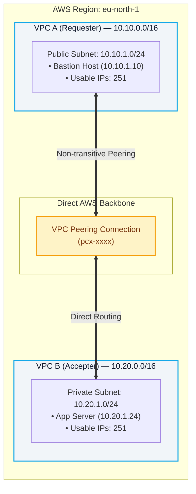
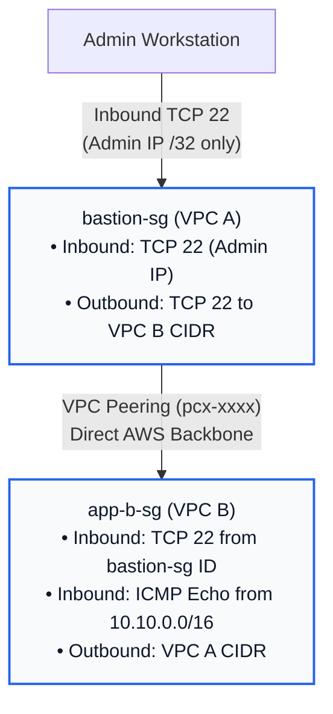
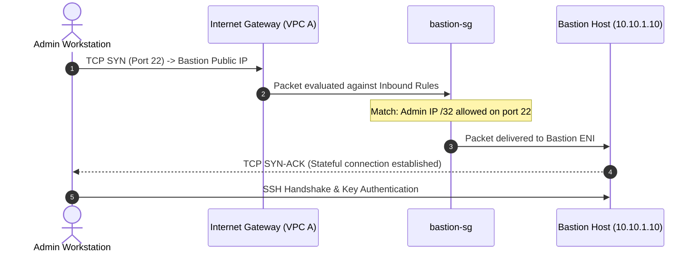
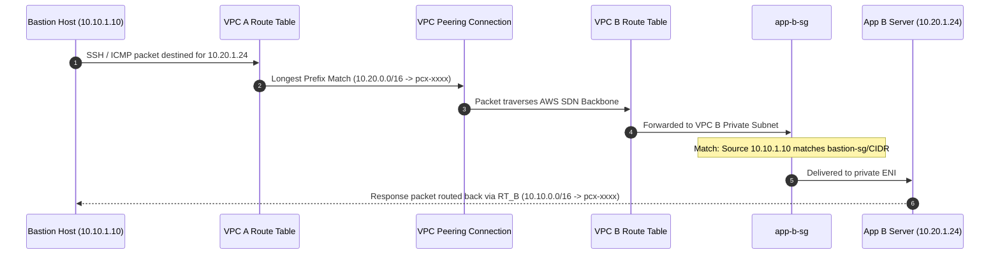

# Architectural Specification — AWS VPC Peering

## Executive Summary

This document details the architectural design for private cross-network connectivity between two isolated Amazon Web Services (AWS) Virtual Private Clouds (VPCs) in the `eu-north-1` (Stockholm) region. 

The architecture implements a secure **Bastion Host (Jump Host)** topology in **VPC A** to administer an isolated, private workload residing in **VPC B** over a high-performance, point-to-point **VPC Peering Connection**.

---

## 1. Network Topology & CIDR Allocation

A foundational requirement for VPC Peering is that the peering VPCs must possess non-overlapping IPv4 CIDR blocks.

### CIDR Subnetting Matrix

| Network Entity | IPv4 CIDR | Netmask | Total Addresses | Usable AWS Addresses | Function / Workload |
|---|---|---|---|---|---|
| **VPC A** | `10.10.0.0/16` | `255.255.0.0` | 65,536 | 65,531 | Ingress & Administration VPC |
| **VPC A Public Subnet** | `10.10.1.0/24` | `255.255.255.0` | 256 | 251 | Bastion Jump Host (`10.10.1.10`) |
| **VPC B** | `10.20.0.0/16` | `255.255.0.0` | 65,536 | 65,531 | Private Application Workload VPC |
| **VPC B Private Subnet**| `10.20.1.0/24` | `255.255.255.0` | 256 | 251 | Private Target Instance (`10.20.1.24`) |

> **AWS Subnet IP Reservations**: In any `/24` AWS subnet (256 addresses), AWS reserves 5 IP addresses:
> - `x.x.x.0`: Network address.
> - `x.x.x.1`: Reserved by AWS for the VPC router.
> - `x.x.x.2`: Reserved by AWS for DNS (AmazonProvidedDNS).
> - `x.x.x.3`: Reserved by AWS for future use.
> - `x.x.x.255`: Network broadcast address (not supported in AWS VPC, but reserved).

---

## 2. VPC Peering Mechanics

### Physical & Logical Transport
VPC Peering does not rely on physical cables, dedicated hardware routers, VPN tunnels, or NAT gateways. Instead, AWS maps VPC peering connections onto its Software-Defined Network (SDN) virtualization layer (AWS Hyperplane / Nitro network virtualization).

- **Encryption & Isolation**: Traffic travels entirely within the private AWS global network infrastructure. Traffic is never exposed to the public internet and cannot be intercepted by third-party AWS tenants.
- **No Gateway Bottleneck**: Unlike NAT Gateways, Virtual Private Gateways (VGW), or internet proxies, a VPC Peering connection has no single physical point of congestion or aggregate bandwidth choke. It supports the maximum throughput allowed by the attached EC2 network adapters (ENA).
- **MTU Limits**: Intra-region VPC peering supports standard Ethernet frames (1500 bytes) and Jumbo Frames (9001 bytes).

### The Non-Transitive Peering Rule
A fundamental networking constraint enforced by AWS is that **VPC Peering is strictly non-transitive**:
- If VPC A is peered with VPC B, and VPC B is peered with VPC C, **VPC A cannot reach VPC C** through VPC B.
- Similarly, an Internet Gateway attached to VPC A cannot be used as an edge router for VPC B. Traffic from VPC B targeting the internet (`0.0.0.0/0`) cannot traverse the peering link to exit via VPC A's Internet Gateway. If VPC B requires internet access, it must be provisioned with its own NAT Gateway in a public subnet or use VPC Endpoints.

---

## 3. Route Table Routing Architecture

Routing in an AWS VPC is governed by route tables associated with individual subnets. For traffic to flow across a peering connection, both VPCs must have explicit route table entries pointing to the peering connection ID (`pcx-xxxx`).

### VPC A Public Route Table (`VPC-A-Public-RT`)

Associated Subnet: `VPC-A-Public-Subnet` (`10.10.1.0/24`)

| Destination CIDR | Target | Purpose | Status |
|---|---|---|---|
| `10.10.0.0/16` | `local` | Internal VPC A routing | Active (System Default) |
| `0.0.0.0/0` | `igw-xxxx` | Ingress SSH administration and outbound updates | Active |
| `10.20.0.0/16` | `pcx-xxxx` | Cross-VPC traffic destined for VPC B | Active |

### VPC B Private Route Table (`VPC-B-Private-RT`)

Associated Subnet: `VPC-B-Private-Subnet` (`10.20.1.0/24`)

| Destination CIDR | Target | Purpose | Status |
|---|---|---|---|
| `10.20.0.0/16` | `local` | Internal VPC B routing | Active (System Default) |
| `10.10.0.0/16` | `pcx-xxxx` | Return traffic and cross-VPC communication with VPC A | Active |

> **Critical Routing Principle**: AWS VPC routing operates on the **Longest Prefix Match (LPM)** rule. When Bastion sends a packet to `10.20.1.24`, the route table evaluates `10.20.0.0/16` (`/16`) versus `0.0.0.0/0` (`/0`). Because `/16` is more specific than `/0`, the packet is routed over `pcx-xxxx` rather than through the internet gateway.

---

## 4. Security Group Ingress / Egress Architecture

Security Groups act as stateful virtual firewalls operating at the Elastic Network Interface (ENI) level.

### Bastion Security Group (`bastion-sg`)
- **Inbound**:
  - `TCP 22` (SSH): Authorized Admin Workstation IP (`<admin_ip>/32`).
- **Outbound**:
  - `TCP 22` (SSH): Allowed to `10.20.1.0/24` (or `0.0.0.0/0`).
  - `TCP 80 / 443`: Allowed to internet for security patching (dnf/yum).
  - `ICMP Echo Request`: Allowed to `10.20.0.0/16` for diagnostics.

### Private App Security Group (`app-b-sg`)
- **Inbound**:
  - `TCP 22` (SSH): Restricted to `bastion-sg` security group reference (intra-region cross-VPC security group referencing is supported by AWS) or `10.10.1.0/24`.
  - `ICMP Type 8 Code 0` (Echo Request): Restricted to `10.10.0.0/16`.
- **Outbound**:
  - Stateful response traffic automatically allowed by AWS security group state tracking. Explicit rule permits outbound traffic back to `10.10.0.0/16`.

---

## 5. End-to-End Traffic Flow Sequences

### Sequence 1: Administrator SSH Connection to Bastion

### Sequence 2: Jump Host Relaying to Private Workload (VPC B)

