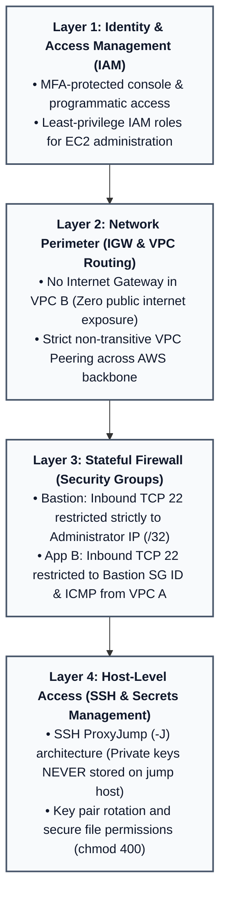

# Security Architecture & Best Practices

## Security Principles & Threat Model

In a cloud network architecture, private network connectivity must be secured with defense-in-depth and least-privilege principles.



---

## 1. Bastion Host Hardening

### The Hazard of `0.0.0.0/0` for SSH
Opening port 22 to `0.0.0.0/0` (the entire internet) exposes the bastion host to continuous automated vulnerability scanning, brute-force dictionary attacks, and SSH zero-day exploits.

- **Strict Requirement**: Inbound SSH access must be limited exclusively to the administrator's specific external IPv4 address using CIDR `/32`:
  ```hcl
  ingress {
    description = "SSH from Administrator workstation"
    from_port   = 22
    to_port     = 22
    protocol    = "tcp"
    cidr_blocks = ["203.0.113.25/32"] # Replace with current workstation IP
  }
  ```
- **Dynamic IP Best Practice**: When working from home where ISPs rotate public IP addresses, check your public IP before connecting (`curl -s https://checkip.amazonaws.com`) and update the security group rule or use an automated update script.

---

## 2. Secrets Management & SSH Key Handling

### The Anti-Pattern: Storing Private Keys on the Bastion
A common security mistake is using `scp` to copy the private key (`key.pem`) to the Bastion host and then executing `ssh -i key.pem ec2-user@10.20.1.24` from the Bastion shell.
- **Why this is insecure**: If the Bastion host is ever compromised, the attacker gains immediate ownership of the private key and full administrative access to all backend servers in VPC B.

### Recommended Pattern: SSH ProxyJump (`-J`)
Modern OpenSSH supports the `-J` (ProxyJump) flag. The connection tunnels through the bastion directly from your local terminal. The bastion acts merely as a TCP packet relay; **your private key never leaves your local machine**.

```bash
# Connect directly to App B in VPC B via Bastion Host
ssh -J ec2-user@<BASTION_PUBLIC_IP> -i ~/.ssh/my-key.pem ec2-user@10.20.1.24
```

### Local OpenSSH Client Configuration
Add this configuration to your local `~/.ssh/config`:

```ssh-config
# VPC A Bastion Jump Host
Host aws-bastion
    HostName <BASTION_PUBLIC_IP>
    User ec2-user
    IdentityFile ~/.ssh/my-key.pem
    IdentitiesOnly yes

# VPC B Private App Instance (via Bastion)
Host aws-app-b
    HostName 10.20.1.24
    User ec2-user
    IdentityFile ~/.ssh/my-key.pem
    ProxyJump aws-bastion
    IdentitiesOnly yes
```
With this setup, connecting to the private instance is seamless and secure:
```bash
ssh aws-app-b
```

---

## 3. Cross-VPC Security Group Referencing

When VPCs reside in the **same AWS Region**, AWS Security Groups support cross-VPC referencing:
- Rather than opening port 22 in `app-b-sg` to an entire IP subnet (`10.10.1.0/24`), you can configure the inbound rule in `app-b-sg` to reference the **Security Group ID** of the bastion host (`sg-xxxxxxxx` / `bastion-sg`).
- **Advantage**: Even if an unauthorized instance is launched inside VPC A's subnet, it cannot access App B unless explicitly attached to the authorized `bastion-sg`.

---

## 4. Modern Enterprise Alternative: AWS Systems Manager (SSM)

While this project demonstrates the classic Bastion Host architecture, enterprise AWS environments increasingly replace SSH Bastions with **AWS Systems Manager Session Manager**.

| Feature | Classic SSH Bastion | AWS SSM Session Manager |
|---|---|---|
| **Port 22 Inbound** | Required in Security Group | **Not Required (0 Inbound ports open)** |
| **Public IP Address** | Required on Bastion | **Not Required (Private Subnet / Endpoints)** |
| **SSH Key Management**| Manual key pairs (`.pem`) | **No SSH keys needed (IAM Credentials)** |
| **Audit Logging** | Local syslog / bash history | **CloudTrail + S3/CloudWatch Session Logs** |
| **MFA Support** | Requires PAM modules | **Native AWS IAM MFA Integration** |

To transition to SSM:
1. Attach the `AmazonSSMManagedInstanceCore` IAM managed policy to an EC2 Instance Profile.
2. Associate the instance profile with the EC2 instances.
3. Connect using AWS CLI:
   ```bash
   aws ssm start-session --target <instance-id>
   ```

---

## 5. Security Checklist & Audit Controls

- [x] VPC CIDRs are private (RFC 1918) and non-overlapping.
- [x] VPC B has no Internet Gateway attached.
- [x] VPC B private subnet has `map_public_ip_on_launch = false`.
- [x] Inbound SSH (TCP 22) on Bastion is restricted to a single `/32` administrator IP.
- [x] Inbound SSH on App B is restricted to `bastion-sg` or `10.10.1.0/24`.
- [x] Private SSH keys are never uploaded or stored on the Bastion EC2 filesystem.
- [x] Root volumes on EC2 instances are encrypted at rest using AWS KMS (`aws/ebs`).
- [x] Default Security Groups deny all inbound traffic unless explicitly permitted.
