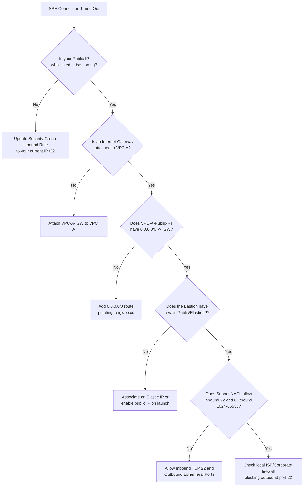

# Troubleshooting & Diagnostic Guide

This guide provides systematic root cause analysis and diagnostic workflows for common network connectivity issues encountered in AWS VPC Peering and Bastion Host environments.

---

## 1. Deep Dive: Resolving Bastion Host SSH Connection Timeouts

### Symptom
When attempting to connect from your local terminal:
```bash
ssh -i my-key.pem ec2-user@<BASTION_PUBLIC_IP>
# Output:
ssh: connect to host <BASTION_PUBLIC_IP> port 22: Connection timed out
```

A **Connection Timed Out** error indicates that TCP SYN packets are being dropped silently along the network path without receiving a TCP RST or ICMP Destination Unreachable response.

### Root Cause Decision Tree



### Detailed Diagnostics & Fixes

#### Cause 1: Stale or Missing Client IP in Security Group
- **Cause**: Home internet connections typically have dynamic IP addresses that change when routers reboot. If `bastion-sg` was whitelisted for a previous IP, packets will be dropped by AWS security groups.
- **Verification**:
  ```bash
  # Check your current external IPv4:
  curl -4 https://checkip.amazonaws.com
  ```
- **Remediation**:
  Compare the returned IP with the CIDR in `bastion-sg` inbound rules. Update the rule to `<YOUR_CURRENT_IP>/32`.

#### Cause 2: Route Table Missing Default Internet Gateway Route
- **Cause**: The subnet where the Bastion was launched is associated with a route table that lacks a route to the Internet Gateway.
- **Verification**:
  Open AWS Console > VPC > Route Tables > Select table associated with `10.10.1.0/24`. Check the **Routes** tab.
- **Remediation**:
  Add destination `0.0.0.0/0` with target `igw-xxxx`.

#### Cause 3: Subnet Association Missing
- **Cause**: `VPC-A-Public-Subnet` was left associated with the VPC's Main Route Table (which has no IGW route) instead of the custom Public Route Table.
- **Remediation**:
  Go to Route Tables > Select `VPC-A-Public-RT` > **Subnet Associations** > **Edit subnet associations** > Select `10.10.1.0/24`.

#### Cause 4: Bastion Instance Has No Public IPv4
- **Cause**: The EC2 instance was launched with "Auto-assign public IP" disabled, meaning it only has a private IP (`10.10.1.10`) and is unreachable from the internet.
- **Verification**:
  In EC2 Console, select `Bastion-Host` and verify the **Public IPv4 address** field is populated.
- **Remediation**:
  Allocate an Elastic IP in the AWS VPC Console and associate it with the Bastion instance's network interface.

#### Cause 5: Stateless Network ACL (NACL) Blocking Return Traffic
- **Cause**: Unlike stateful Security Groups, Network ACLs are **stateless**. If custom NACLs were configured, outbound return traffic on ephemeral ports (1024-65535) might be blocked.
- **Remediation**:
  Ensure Inbound NACL allows port 22, and Outbound NACL allows TCP ports 1024-65535 (ephemeral ports) to `0.0.0.0/0`.

---

## 2. VPC Peering Cross-VPC Connectivity Issues

### Symptom: Bastion Cannot Ping or SSH into Private App B (`10.20.1.24`)

#### Checklist & Root Causes:

1. **Peering Status is `Pending-Acceptance`**:
   - A peering connection remains inactive until the accepter VPC owner explicitly accepts the request.
   - **Verification**: In VPC Console > Peering Connections, verify status is `Active`. If `Pending-Acceptance`, select **Actions > Accept Request**.

2. **Asymmetric Routing (One-Way Route Configured)**:
   - Traffic can reach VPC B, but VPC B does not know how to send return packets back to VPC A.
   - **Verification**:
     - Check `VPC-A-Public-RT`: must contain `10.20.0.0/16` -> `pcx-xxxx`.
     - Check `VPC-B-Private-RT`: must contain `10.10.0.0/16` -> `pcx-xxxx`.
   - **Remediation**: Add the missing route to the return route table.

3. **Security Group Dropping ICMP (Ping)**:
   - Many engineers test connectivity using `ping 10.20.1.24`. If ping fails, they assume peering is broken, when in fact peering is active and only ICMP packets are dropped by the firewall.
   - **Verification**:
     Check `app-b-sg`. Does it include an inbound rule for `Custom ICMP - IPv4` (Echo Request) from `10.10.0.0/16`?
   - **Alternative TCP Test (Independent of ICMP)**:
     From the Bastion shell, test TCP port 22 directly using `nc` (netcat):
     ```bash
     nc -zvw3 10.20.1.24 22
     # Expected output if peering and SG are working:
     # Connection to 10.20.1.24 22 port [tcp/ssh] succeeded!
     ```

4. **Target Instance Not Running or in Wrong Subnet**:
   - Verify `App-B-Instance` is in the `running` state.
   - Verify its private IP address matches `10.20.1.24` (or whatever IP was dynamically assigned within `10.20.1.0/24`).

---

## 3. Diagnostic Tool Cheat Sheet

Run these commands from the **Bastion Host** shell to isolate network layers:

| Diagnostic Goal | Command | Expected Output |
|---|---|---|
| **Verify Local IP & Interface** | `ip addr show` | Confirms ENI has `10.10.1.x` assigned |
| **Verify Local Route Table** | `ip route show` | Shows default gateway (`10.10.1.1`) |
| **Test ICMP Reachability to App B** | `ping -c 4 10.20.1.24` | 0% packet loss |
| **Test TCP SSH Port to App B** | `nc -zvw3 10.20.1.24 22` | `Connection to 10.20.1.24 22 port [tcp/ssh] succeeded!` |
| **Trace Route Path** | `traceroute -n 10.20.1.24` | Shows direct hop over AWS backbone |
| **Verify DNS Resolution** | `dig amazon.com` | Resolves via `10.10.0.2` (AmazonProvidedDNS) |
